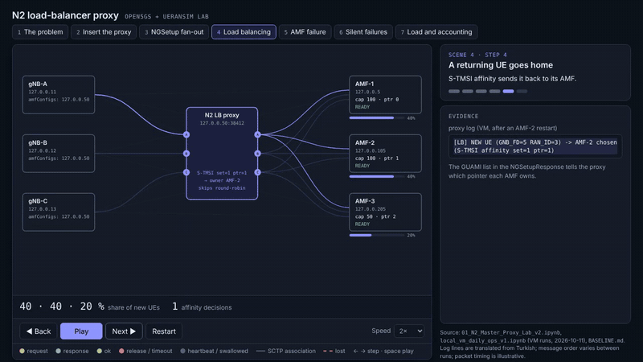

# ngap-proxy

A transparent **NGAP/SCTP (N2) proxy** that puts a pool of AMFs behind a single address.
gNBs see one AMF; the proxy keeps one association per gNB and AMF, spreads new UEs
by AMF capacity, keeps returning UEs on their AMF, and survives AMF failures without
the gNB noticing.

Built and validated in an **Open5GS + UERANSIM** lab. Single C++17 source tree, no
dependencies beyond `libsctp`.

> **Status: lab and education tool, not a production load balancer.** It is single
> threaded, has no write queue and no slice awareness (see [Limitations](#limitations)).



[60 s video](docs/media/n2-proxy-walkthrough.mp4) ·
[Interactive walkthrough](docs/walkthrough/n2-proxy-walkthrough.html) (single HTML file: download and open it, or serve it with GitHub Pages)

## Why

The standard N2 setup is a full mesh: every gNB carries the whole AMF pool in its
config and holds its own SCTP association to each AMF. Three gNBs and three AMFs
give nine associations, and every RAN node has to implement pool logic itself.
In the lab, `kill -9` on one AMF leaves six associations and no central place that
reacts. The proxy moves that logic to one component:

- **RAN side:** one association per gNB, to the proxy.
- **Core side:** one association per gNB and AMF, owned by the proxy.
- **Transparent:** it does not rewrite UE NGAP IDs; UEs are keyed by `(gNB, RAN_UE_NGAP_ID)`.

## Features

| Area | What it does |
|---|---|
| Attach | Forwards `NGSetupRequest` to every AMF, passes the first success to the gNB and swallows the rest. |
| UE selection | Smooth weighted round-robin; weight is the AMF's `RelativeAMFCapacity` (lab: 100/100/50 gives 40/40/20 %). |
| Affinity | A returning UE with a 5G-S-TMSI goes to the AMF that owns the GUAMI pointer. A stale S-TMSI (AMF releases it within 1.5 s) falls back to WRR for 60 s. |
| Drain | `drain N` / `undrain N` / `status` through a control file: a drained AMF takes no new UEs but keeps its own. |
| AMF failure | Cleans up that AMF's UEs and sends a per-UE `UEContextReleaseCommand` (UERANSIM ignores NG Reset; `reset` mode is available). Reconnects with backoff and replays the saved `NGSetupRequest`; the duplicate response is swallowed. |
| Silent failures | SCTP heartbeat (1 s, `path_max_retrans` 2), a 5 s `NGSetup` timeout, and an opt-in application-level probe (`RANConfigurationUpdate`) that catches a `SIGSTOP`ped AMF. |
| Observability | Prometheus `/metrics` and a **message-conservation** check: `gnb_to_proxy + amf_to_proxy + mcast_extra + injected == proxy_to_gnb + proxy_to_amf + swallowed + dropped`. |

## Quick start

```sh
cd proxy
make                 # needs libsctp-dev
make test            # unit + logic tests, no SCTP needed (pip install pycrate)
make syntax-sctp     # syntax-check the real SCTP code path without libsctp-dev

N2P_LISTEN=127.0.0.50:38412 \
N2P_AMFS=127.0.0.5:38412,127.0.0.105:38412,127.0.0.205:38412 \
N2P_METRICS=127.0.0.1:9190 \
./n2proxy_master
```

Point each gNB's `amfConfigs` at the `N2P_LISTEN` address.

| Variable | Default | Meaning |
|---|---|---|
| `N2P_LISTEN` | `127.0.0.50:38412` | `ip:port` the gNBs connect to |
| `N2P_AMFS` | three lab AMFs on `127.0.0.5`, `.105`, `.205` (port 38412) | comma-separated `ip:port` list |
| `N2P_ON_AMF_LOSS` | `release` | `release` (per-UE release), `reset` (NG Reset), `silent` |
| `N2P_HB_MS` | `1000` | SCTP heartbeat interval |
| `N2P_PROBE_MS` | `0` (off) | application-level probe interval |
| `N2P_AFFINITY` | `on` | 5G-S-TMSI affinity; `off` disables it |
| `N2P_STALE_MS` | `60000` | how long a rejected S-TMSI is treated as stale |
| `N2P_SETUP_TIMEOUT_MS` | `5000` | backend connect / `NGSetup` timeout |
| `N2P_METRICS` | off | `ip:port` for `/metrics` |
| `N2P_CTL` | unset | control file for `drain` / `undrain` / `status` |

## Tests and results

Test pyramid:

1. **Unit** (`make -C proxy test`): 111 checks with pycrate APER vectors, under ASan/UBSan.
2. **Logic** (same target): 79 checks with a mock AMF and gNB over a TCP transport, including the load generator.
3. **VM `chaos_suite`** (`lab/`): real SCTP, Open5GS and UERANSIM. It covers baseline, kill -9, black hole, reconnect, weights, drain, probe and `SIGSTOP`, with PASS/FAIL/XFAIL asserts.

Synthetic registration load, 3 gNBs through the proxy to 3 AMFs (VM runs):

| offered | answered | p95 | SCP `Connection timer expired` | proxy conservation |
|---|---|---|---|---|
| 150/s | 100 % | 20 ms | 0 | holds |
| 250/s | 80 % | 16 ms | 60 | holds |
| 300/s | 76 % | 14 ms | 72 | holds |
| 350/s | 58 % | 16 ms | 122 | holds |

The loss is **not** in the proxy: the unanswered UEs match the SCP SBI timeouts almost
one to one, the proxy drops nothing (about 1 % CPU, 1.7 MB RSS), and a control run
without the proxy at the same total rate (300/s, straight to AMF-1) still loses 13 %.
The limit sits in the 5GC's shared SBI path (AMF → SCP → AUSF/UDM/UDR); the root cause
inside the 5GC is not pinned down. Run-to-run variation is about ±15 points. The load
uses fake NAS, so it exercises N2 and the SBI path, not a full registration.

## Related work

Standard cloud load balancers mostly do not handle SCTP. Closest to this project is
[LoxiLB](https://github.com/loxilb-io/loxilb) (open source, eBPF, CNCF Sandbox), which documents
NGAP-aware AMF balancing. The Linux kernel's IPVS can balance SCTP at L4 but does not
parse NGAP. 3GPP itself already lets a gNB choose within an AMF set (AMF Set/Pointer and
TNL association weights, TS 23.502), so this proxy is for setups that want a single N2
address in front of the pool. This project makes no performance claims against any of them.

## Limitations

- Single thread, no write queue (a message is dropped on `EAGAIN`).
- No slice awareness: the requested NSSAI is inside ciphertext NAS.
- No release command for UEs whose AMF UE NGAP ID was never learned (falls back to NG Reset).
- No handover / Xn-N2 path, targeted paging, or multiple proxy instances (HA pair).
- Termination at the proxy means no end-to-end SCTP multi-homing.
- The probe is opt-in; re-validate real AMF behavior with `probe_healthy` before enabling it.
- The lab notebooks and several design documents are in **Turkish**.

## Repository layout

```
proxy/    C++ sources (src/), Makefile, unit and logic tests (tests/)
lab/      VM tooling: chaos_suite.py, load_gen.py, notebooks, setup scripts, topology notes
docs/     walkthrough animation and video
```

Deeper notes: [`proxy/README.md`](proxy/README.md) (design, per-phase changes, validation log),
[`lab/PROJECT_SUMMARY_AND_ROADMAP.md`](lab/PROJECT_SUMMARY_AND_ROADMAP.md),
[`lab/TOPOLOGY.md`](lab/TOPOLOGY.md), [`lab/BASELINE.md`](lab/BASELINE.md) (Turkish).

## License

Apache-2.0, see [LICENSE](LICENSE).
