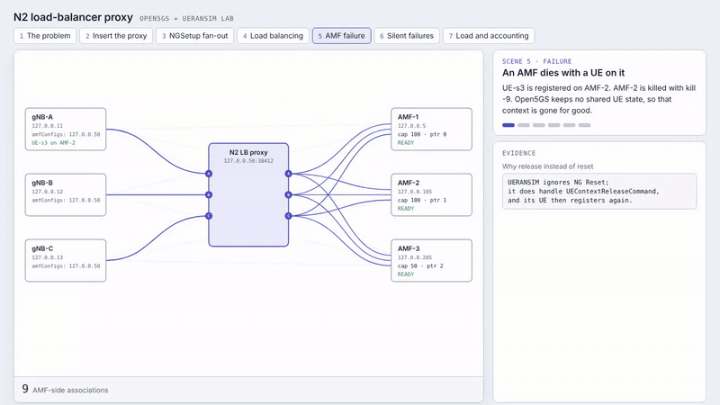

# ngap-proxy

[](LICENSE)
[](https://github.com/cem8kaya/ngap-proxy)
[](https://www.3gpp.org/)
[](#why-i-built-it)
[](proxy/)
[](lab/)
[](#limitations)

A transparent NGAP/SCTP (N2) proxy that puts a pool of AMFs behind a single address.
The gNB sees one AMF. Behind it, the proxy keeps one association per gNB and AMF,
spreads new UEs by AMF capacity, keeps returning UEs on their AMF, and rides out AMF
failures without the gNB noticing.

I wrote it in my local 5G lab (Open5GS + UERANSIM) to understand how N2 pool handling
really behaves. It is a lab and learning tool, not a production load balancer.



The full walkthrough is also available as a [60 second video](docs/media/n2-proxy-walkthrough-light.mp4)
and as an [interactive page](docs/walkthrough/n2-proxy-walkthrough.html) (download the HTML file and open it locally).

## Why I built it

In the standard N2 setup every gNB holds its own SCTP association to every AMF, and the
AMF pool lives in each RAN node's configuration. Three gNBs and three AMFs make nine
associations, and every RAN node carries the pool logic itself. In my lab, `kill -9` on
one AMF left six associations and no single place that reacts to it.

3GPP lets the gNB choose within an AMF Set (AMF Pointer, relative capacity, TNL weights,
see TS 23.502), and that works. The cost shows up in operations: adding, draining or
replacing an AMF means touching every gNB, failure behavior depends on the RAN vendor,
and nobody can see the pool from one place. Cloud-native cores make it harder, since most
load balancers do not speak SCTP, let alone NGAP.

The proxy moves that logic into one component. On the RAN side there is one association
per gNB. On the core side there is one association per gNB and AMF. UE NGAP IDs are not
rewritten; UEs are keyed by `(gNB, RAN_UE_NGAP_ID)`.

## What it does

- **Attach:** forwards `NGSetupRequest` to every AMF, passes the first success to the gNB and swallows the other responses.
- **UE selection:** smooth weighted round-robin, using each AMF's `RelativeAMFCapacity` (100/100/50 in my lab gives 40/40/20 %).
- **Affinity:** a returning UE with a 5G-S-TMSI goes back to the AMF that owns its GUAMI pointer. If that AMF releases it within 1.5 s, the S-TMSI is treated as stale for 60 s and selection falls back to round-robin.
- **Drain:** `drain N`, `undrain N` and `status` through a control file. A drained AMF takes no new UEs but keeps the ones it has.
- **AMF failure:** cleans up that AMF's UEs and sends a `UEContextReleaseCommand` per UE (UERANSIM ignores NG Reset, so a `reset` mode is optional). It reconnects with backoff and replays the saved `NGSetupRequest`, swallowing the duplicate response.
- **Silent failures:** SCTP heartbeat (1 s, `path_max_retrans` 2), a 5 s `NGSetup` timeout, and an optional application-level probe (`RANConfigurationUpdate`) that catches a `SIGSTOP`ped AMF.
- **Observability:** Prometheus `/metrics`, plus a message-conservation check: `gnb_to_proxy + amf_to_proxy + mcast_extra + injected == proxy_to_gnb + proxy_to_amf + swallowed + dropped`.

## Quick start

```sh
cd proxy
make                 # needs libsctp-dev
make test            # unit and logic tests, no SCTP needed (pip install pycrate)
make syntax-sctp     # syntax-check the real SCTP path without libsctp-dev

N2P_LISTEN=127.0.0.50:38412 \
N2P_AMFS=127.0.0.5:38412,127.0.0.105:38412,127.0.0.205:38412 \
N2P_METRICS=127.0.0.1:9190 \
./n2proxy_master
```

Point each gNB's `amfConfigs` at the `N2P_LISTEN` address.

| Variable | Default | Meaning |
|---|---|---|
| `N2P_LISTEN` | `127.0.0.50:38412` | address the gNBs connect to |
| `N2P_AMFS` | lab AMFs on `127.0.0.5`, `.105`, `.205` (port 38412) | comma-separated `ip:port` list |
| `N2P_ON_AMF_LOSS` | `release` | `release`, `reset` (NG Reset) or `silent` |
| `N2P_HB_MS` | `1000` | SCTP heartbeat interval |
| `N2P_PROBE_MS` | `0` (off) | application-level probe interval |
| `N2P_AFFINITY` | `on` | 5G-S-TMSI affinity; `off` disables it |
| `N2P_STALE_MS` | `60000` | how long a rejected S-TMSI counts as stale |
| `N2P_SETUP_TIMEOUT_MS` | `5000` | backend connect and `NGSetup` timeout |
| `N2P_METRICS` | off | address for `/metrics` |
| `N2P_CTL` | unset | control file for `drain`, `undrain`, `status` |

## Tests and results

I test in three layers:

1. Unit tests (`make -C proxy test`): 111 checks on pycrate APER vectors, under ASan and UBSan.
2. Logic tests (same target): 79 checks with a mock AMF and gNB over a TCP transport, including the load generator.
3. VM chaos suite (`lab/chaos_suite.py`): real SCTP, Open5GS and UERANSIM. It covers baseline, `kill -9`, black hole, reconnect, weights, drain, probe and `SIGSTOP`, with PASS, FAIL and XFAIL asserts.

Synthetic registration load, 3 gNBs through the proxy to 3 AMFs (VM runs):

| Offered | Answered | p95 | SCP `Connection timer expired` | Proxy conservation |
|---|---|---|---|---|
| 150/s | 100 % | 20 ms | 0 | holds |
| 250/s | 80 % | 16 ms | 60 | holds |
| 300/s | 76 % | 14 ms | 72 | holds |
| 350/s | 58 % | 16 ms | 122 | holds |

The loss is not in the proxy. The unanswered UEs match the SCP SBI timeouts almost one
to one, the proxy drops nothing (about 1 % CPU and 1.7 MB RSS), and a control run without
the proxy at the same total rate (300/s, straight to one AMF) still loses 13 %. The
limit sits in the 5GC's shared SBI path (AMF, SCP, AUSF, UDM, UDR); I have not pinned
down the root cause inside the 5GC. Run-to-run variation is about 15 points, and the load
uses fake NAS, so it exercises N2 and the SBI path rather than a full registration.

## Related work

[LoxiLB](https://github.com/loxilb-io/loxilb) (open source, eBPF, CNCF Sandbox) is the
closest project I found and documents NGAP-aware AMF balancing. Linux IPVS can balance
SCTP at L4 but does not parse NGAP. This project makes no performance claims against
either of them.

## Limitations

- Single thread, no write queue (a message is dropped on `EAGAIN`).
- No slice awareness: the requested NSSAI is inside ciphertext NAS.
- No release command for UEs whose AMF UE NGAP ID was never learned (falls back to NG Reset).
- No handover, Xn-N2 path, targeted paging or multiple proxy instances (HA pair).
- Terminating SCTP at the proxy means no end-to-end SCTP multi-homing.
- The probe is optional; check real AMF behavior with `probe_healthy` before enabling it.
- The lab notebooks and several design documents are in Turkish.

## Repository layout

```
proxy/    C++ sources (src/), Makefile, unit and logic tests (tests/)
lab/      VM tooling: chaos suite, load generator, notebooks, setup scripts, topology notes
docs/     walkthrough animation and video
```

More detail: [proxy/README.md](proxy/README.md) (design, per-phase changes, validation log),
[lab/PROJECT_SUMMARY_AND_ROADMAP.md](lab/PROJECT_SUMMARY_AND_ROADMAP.md),
[lab/TOPOLOGY.md](lab/TOPOLOGY.md) and [lab/BASELINE.md](lab/BASELINE.md) (Turkish).

## Contributing

Feedback, issues and pull requests are welcome, especially from people who run N2 in
real networks.

## License

Apache 2.0, see [LICENSE](LICENSE).
